# StayFit

## ℹ️ General Info

This is the repository responsible for StayFit apps.

## 🏭 Applications

-   [Backend](./backend) — StayFit application backend.

    _To work properly, fill in the **`.env`** file. Use the **`.env.example`** file as an example._

-   [Frontend](./frontend) — StayFit application frontend.

    _To work properly, fill in the **`.env`** file. Use the **`.env.example`** file as an example._

-   [Shared](./shared) — StayFit application common modules for reuse.

## 🖍 Requirements

-   [NodeJS](https://nodejs.org/en/) (18.x.x);
-   [NPM](https://www.npmjs.com/) (9.x.x);
-   [PostgreSQL](https://www.postgresql.org/) (15.2)
-   run **`npx simple-git-hooks`** at the root of the project, before the start (it will set the [pre-commit hook](https://www.npmjs.com/package/simple-git-hooks) for any commits).

## 💽 DB Schema

```mermaid
erDiagram
    users {
        id integer PK
        email character_varying(255)
        password_hash text
        created_at timestamp
        updated_at timestamp
        stripe_customer_id character_varying(255)
    }

    user_details {
        id integer PK
        user_id integer FK
        full_name character_varying(255)
        avatar_url text
        username character_varying(255)
        date_of_birth date
        weight integer
        height integer
        gender gender_enum
        referral_code character_varying(255)
        bonus_balance integer
        location character_varying(255)
        is_public boolean
        created_at timestamp
        updated_at timestamp
    }

    achievements {
        id integer PK
        name character_varying(255)
        activity_type activity_type_enum
        requirement integer
        requirement_metric requirement_metric_enum
        created_at timestamp
        updated_at timestamp
    }

    user_achievements {
        id integer PK
        user_id integer FK
        achievement_id integer FK
        created_at timestamp
        updated_at timestamp
    }

    schedules {
        id integer PK
        user_id integer FK
        goal_id integer FK
        start_at timestamp
        activity_type activity_type_enum
        created_at timestamp
        updated_at timestamp
    }

    goals {
        id integer PK
        user_id integer FK
        activity_type activity_type_enum
        frequency integer
        frequency_type frequency_type_enum
        distance real
        duration integer
        progress real
        completed_at timestamp
        created_at timestamp
        updated_at timestamp
    }

    subscriptions {
        id integer PK
        user_id integer FK
        plan_id integer FK
        stripe_subscription_id character_varying(255)
        is_canceled boolean
        expires_at timestamp
        status status_enum
        created_at timestamp
        updated_at timestamp
    }

    subscription_plans {
        id integer PK
        name character_varying(255)
        price numeric(8_2)
        description text
        stripe_product_id character_varying(255)
        stripe_price_id character_varying(255)
        created_at timestamp
        updated_at timestamp
    }

    oauth_info {
        id integer PK
        user_id integer FK
        token_type character_varying(255)
        expires_at bigint
        access_token text
        refresh_token text
        scope character_varying(255)
        provider oauth_provider_enum
        created_at timestamp
        updated_at timestamp
        owner_id integer
    }

    workouts {
        id integer PK
        user_id integer FK
        steps real
        activity_id character_varying(255)
        kilocalories real
        heart_rate real
        workout_started_at timestamp
        workout_ended_at timestamp
        distance real
        speed real
        activity_type activity_type_enum
        created_at timestamp
        updated_at timestamp
        provider oauth_provider_enum
    }

    notifications {
        id integer PK
        user_id integer FK
        title character_varying(255)
        message character_varying(255)
        is_read boolean
        type notification_type_enum
        created_at timestamp
        updated_at timestamp
    }

    user_bonuses {
        id integer PK
        user_id integer FK
        amount integer
        created_at timestamp
        updated_at timestamp
        action_type action_type_enum
        transaction_type transaction_type_enum
    }

    oauth_state {
        id integer PK
        user_id integer FK
        uuid character_varying(255)
        created_at timestamp
        updated_at timestamp
        referral_code character_varying(255)
    }

    messages {
        id integer PK
        chat_id integer FK
        sender_id integer FK
        text text
        is_seen boolean
        created_at timestamp
        updated_at timestamp
    }

    chats {
        id integer PK
        is_assistant boolean
        created_at timestamp
        updated_at timestamp
    }

    chats_users {
        id integer PK
        chat_id integer FK
        user_id integer FK
        created_at timestamp
        updated_at timestamp
    }

    friends {
        id integer PK
        user_id integer FK
        following_id integer FK
        created_at timestamp
        updated_at timestamp
    }

    users ||--o{ user_details : user_id
    users ||--o{ user_achievements : user_id
    achievements ||--o{ user_achievements : achievement_id
    users ||--o{ schedules : user_id
    goals ||--o{ schedules : goal_id
    users ||--o{ goals : user_id
    users ||--o{ subscriptions : user_id
    subscription_plans ||--o{ subscriptions : plan_id
    users ||--o{ oauth_info : user_id
    users ||--o{ workouts : user_id
    users ||--o{ notifications : user_id
    users ||--o{ user_bonuses : user_id
    users ||--o{ oauth_state : user_id
    users ||--o{ messages : sender_id
    users ||--o{ friends : user_id
    users ||--o{ friends : following_id
    chats ||--o{ chats_users : chat_id
    users ||--o{ chats_users : user_id
    friends ||--o{ chats : id
    friends ||--o{ messages : chat_id
```



## 🏃‍♂️ Simple Start

1. Install packages: **`npm run install:all`**
2. Fill ENVs
3. Install pre-commit hooks: **`npx simple-git-hooks`**
4. Run migrations: **`npm run migrate:dev -w backend`**
5. Run seeds: **`npm run seed:run -w backend`**
6. Run backend: **`npm run start:dev -w backend`**
7. Run fronend: **`npm run start:dev -w frontend`**

## ️ Storybook

1. Run command: **`npm run storybook`**

### 🌑 Backend

-   [Fastify](https://www.fastify.io/) — a backend framework.
-   [Knex](https://knexjs.org/) — a query builder.
-   [Objection](https://vincit.github.io/objection.js/) — an ORM.

### 🌕 Frontend

-   [Redux](https://redux.js.org/)
-   [Redux Toolkit](https://redux-toolkit.js.org/) — a state manager.
-   [Tailwind CSS](https://tailwindcss.com/) - a CSS framework
-   [Storybook](https://storybook.js.org/) - a UI documentation

### 🥊 Code quality

-   [simple-git-hooks](https://www.npmjs.com/package/simple-git-hooks) — a tool that lets you easily manage git hooks.
-   [lint-staged](https://www.npmjs.com/package/lint-staged) — run linters on git staged files.
-   [dangerjs](https://danger.systems/js/) — automate common code review chores.
-   [commitlint](https://commitlint.js.org/) — helps your team adhere to a commit convention.
-   [editorconfig](https://editorconfig.org/) — helps maintain consistent coding styles for multiple developers working on the same project across various editors and IDEs.
-   [prettier](https://prettier.io/) — an opinionated code formatter.
-   [ls-lint](https://ls-lint.org/) — file and directory name linter.
-   [eslint](https://eslint.org/) — find problems in your JS code.
-   [stylelint](https://stylelint.io/) — find and fix problems in your CSS code.

#### 🏅 Pull Request flow

```
<project-prefix>-<issue-number>: <ticket-title>
```

##### Example

-   `StayFit-5: Add auth`

#### 🌳 Branch flow

```
<type>/<project-prefix>-<issue-number>-<short-desc>
```

##### Types

-   task
-   fix

##### Examples

-   `task/StayFit-5-add-clinician-dashboard`
-   `task/StayFit-12-add-clinician-flow`
-   `fix/StayFit-16-fix-clinician-flow`

#### 🗂 Commit flow

```
<project-prefix>-<issue-number>: <modifier> <description>
```

##### Modifiers

-   `+` (add)
-   `*` (edit)
-   `-` (remove)

##### Examples

-   `StayFit-5: + title for dashboard`
-   `StayFit-12: * dashboard title`
-   `StayFit-16: - dashboard title`

## 📦 CI/CD

CI/CD implemented using [GitHub Actions](https://docs.github.com/en/actions)
